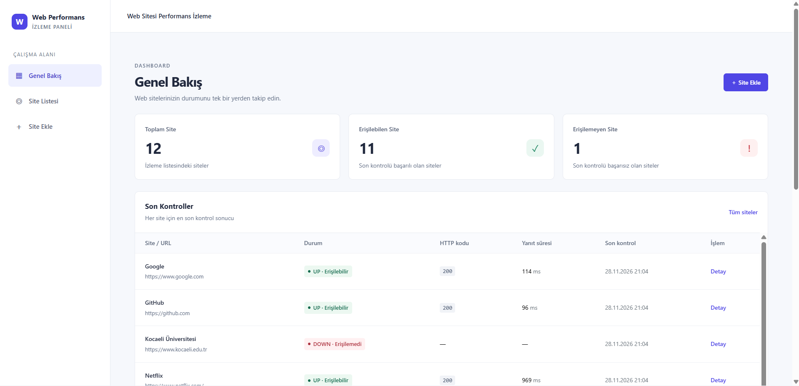
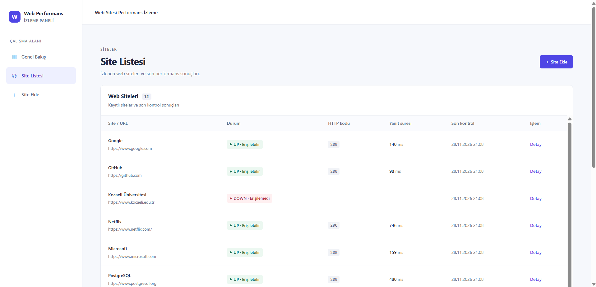
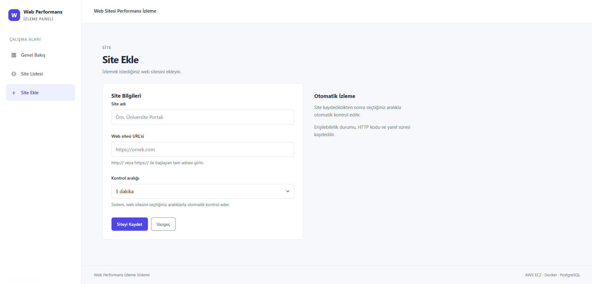
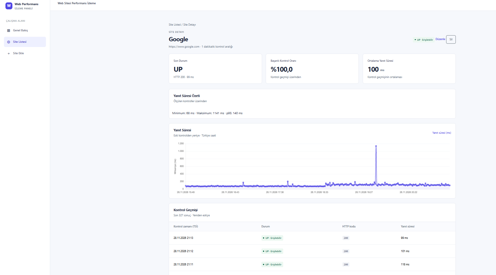
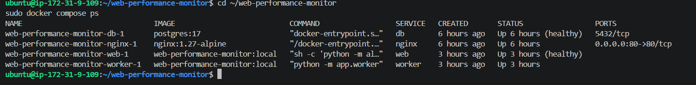
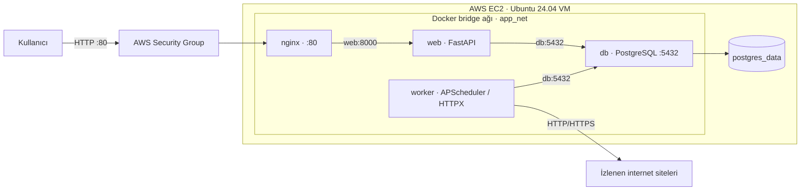
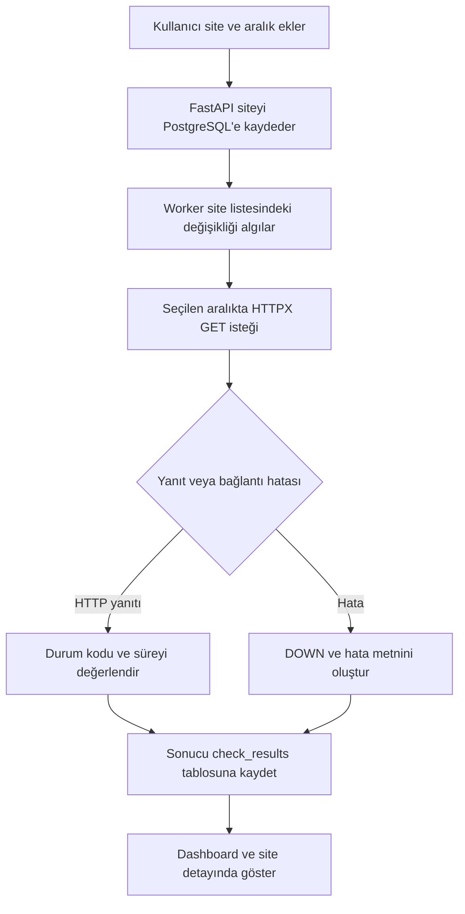
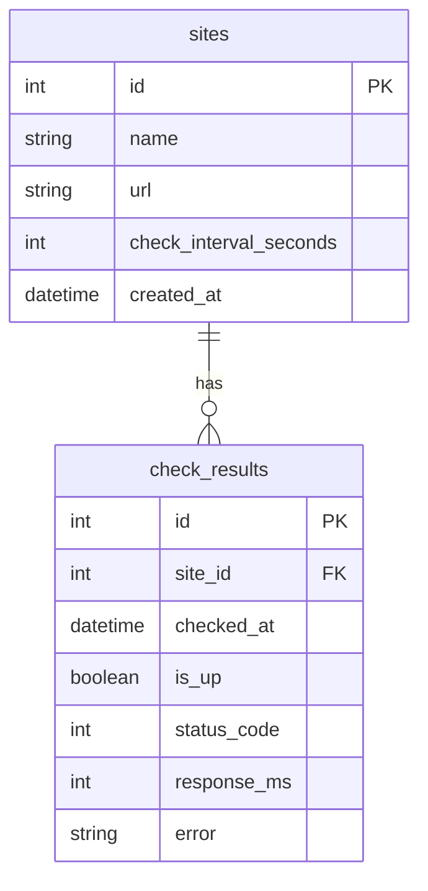

# Web Performans İzleme Sistemi

Bu proje, web sitelerinin **erişilebilirliğini ve HTTP yanıt süresini** belirlenen aralıklarla izler. Siteler web arayüzünden yönetilir; bağımsız worker gerçek HTTP isteklerinin sonuçlarını PostgreSQL'e kaydeder. Dashboard son durumları, site detayı ise geçmişi ve hesaplanan ölçümleri gösterir. Bulut Bilişimde Sanallaştırma Teknolojileri dersi kapsamında uygulama, veritabanı ve ters vekil sunucu AWS EC2 üzerindeki Ubuntu 24.04 sanal makinede Docker Compose ile ayrı konteynerler olarak çalıştırılır.

Bu araç tarayıcıda sayfa yükleme hızını, JavaScript çalışmasını veya Core Web Vitals değerlerini ölçmez. Yanıt süresi, worker'ın HTTP isteğinin yanıt başlıklarını almasına kadar geçen süredir; DNS, bağlantı ve varsa yönlendirmeler bu süreye dahildir.

## Özellikler

- Site ekleme, listeleme, düzenleme ve silme; kontrol aralığını formda 1, 5, 10, 15, 30 veya 60 dakika olarak seçme.
- Her kayıtlı siteyi kendi aralığında otomatik kontrol etme; yeni, güncellenen ve silinen siteleri worker yeniden başlatılmadan algılama.
- Kontrol zamanı, UP/DOWN, HTTP kodu, milisaniye cinsinden yanıt süresi ve varsa hata mesajını saklama.
- Dashboard'da son kontrol durumları; site detayında kontrol geçmişi, Chart.js yanıt süresi grafiği, başarılı kontrol oranı, ortalama, minimum, maksimum ve p95.
- Ölçüm bulunmayan alanları boş gösterme; sahte performans verisi üretmeme.

Şemada aktif/pasif alanı yoktur: kayıtlı tüm siteler izlenir. Kullanıcı girişi ve bildirim sistemi bu sürümde bulunmaz.

## Kullanılan teknolojiler

| Teknoloji | Görevi |
| --- | --- |
| Python 3.12, FastAPI | Web uygulaması ve HTML sayfa yolları |
| HTTPX | Worker'ın gerçek HTTP/HTTPS istekleri |
| APScheduler | Siteye özel periyodik kontrol işleri |
| PostgreSQL 17 | Siteler ve kontrol sonuçları için kalıcı veritabanı |
| SQLAlchemy, Alembic | ORM modelleri, oturum yönetimi ve şema migration'ı |
| Jinja2, Bootstrap, Chart.js | Sunucu tarafı şablonlar, arayüz ve geçmiş grafiği |
| Nginx | Kullanıcı isteklerini FastAPI'ye ileten ters vekil |
| Docker, Docker Compose | Dört servisin imaj, konteyner, ağ ve volume yönetimi |
| AWS EC2, Ubuntu 24.04 | Sistemin çalıştırıldığı bulut sanal makinesi |

## Uygulama Ekran Görüntüleri

Aşağıdaki ekran görüntüleri AWS üzerinde çalışan uygulamadan ve dağıtım ortamından alınmıştır.

### Genel Bakış

12 siteyi izleyen AWS web paneli.



### Site Listesi

Kayıtlı sitelerin erişilebilirlik durumları, HTTP kodları ve yanıt süreleri.



### Site Ekle

Yeni izleme hedefi ve kontrol aralığı tanımlama.



### Site Detayı

Google için yanıt süresi grafiği, başarı oranı, minimum, maksimum, p95 ve geçmiş kontroller.



### AWS Docker

Ubuntu terminalinde çalışan nginx, web, worker ve PostgreSQL konteynerleri.



## Mimari ve sanallaştırma

AWS EC2, Ubuntu 24.04 çalıştıran bir bulut sanal makinesidir. Docker uygulama bileşenlerini ayrı konteynerlere ayırır; `web` ile `worker` aynı Python imajını farklı komutlarla kullanır. Compose'un `app_net` bridge ağı, servislerin birbirine `web` ve `db` adlarıyla erişmesini sağlar. PostgreSQL'in verisi `web-performance-monitor_postgres_data` adlı Docker volume'de tutulur ve konteyner yeniden oluşturulsa da kalır. Böylece EC2 sunucu sanallaştırmasını, konteynerler uygulama izolasyonunu, bridge ağı ağ izolasyonunu ve named volume kalıcı depolama soyutlamasını sağlar.



Yalnızca Nginx host portu yayımlar: yerelde `127.0.0.1:8080`, EC2 için `.env` ayarıyla `0.0.0.0:80`. PostgreSQL `5432` ve FastAPI `8000` Docker ağı içinde kullanılır, doğrudan host portu açmaz. EC2 Security Group gelen trafiği yönetir; **TCP 80'i uygulamaya erişmesine izin verilen IP aralığına, TCP 22'yi yalnızca yönetim IP'nize** açın. Güvenlik grubu kuralları bu depoda tanımlı değildir; gerçek EC2 ayarlarını ayrıca kontrol edin. Bu sürümde web arayüzü için HTTPS ve kullanıcı kimlik doğrulaması yoktur.

## İzleme iş akışı



Worker'ın işleyişi, kodun izlediği sırayla:

```text
zamanlayıcıyı başlat
her 5 saniyede:
    kayıtlı siteleri ve saniye cinsinden aralıklarını veritabanından oku
    eklenen veya aralığı değişen sitelerin işlerini ayarla; silinenlerin işlerini kaldır
her site işi için (aynı siteye eşzamanlı iş açma):
    site satırını kilitle; site silinmişse çık
    kontrol zamanını kaydet
    HTTP/HTTPS adresini ve yönlendirmeleri denetleyerek HTTPX GET gönder
    2xx/3xx → UP; 4xx/5xx veya bağlantı/timeout hatası → DOWN
    kod, süre ve varsa hatayı check_results tablosuna yaz
    tek site işinde beklenmeyen hata olursa logla; worker döngüsünü sürdür
```

Worker site listesini **5 saniyede bir** yeniler. APScheduler her site işi için `max_instances=1` kullanır; PostgreSQL satır kilidi de aynı site kontrollerini sıralar. Her HTTP isteği için HTTPX timeout'u **10 saniyedir**; yönlendirme sayısı en fazla **5** olur. Timeout toplam job süresi için kesin bir üst sınır değildir.

## Veritabanı

Alembic `0001` migration'ı iki tabloyu oluşturur; uygulama açılışında tablo veya sahte veri üretilmez. Site silinince ona bağlı sonuçlar da silinir.



`check_interval_seconds` pozitif saniye değeridir. `status_code`, `response_ms` ve `error` nullable alanlardır. Bağlantı hatasında HTTP kodu ve yanıt süresi boş kalabilir; **0 ms** geçerli bir ölçümdür. Zaman alanları saat dilimi içerir. `check_results.site_id` foreign key ile `sites.id` alanına bağlıdır.

## Ölçüm metrikleri

HTTP **2xx ve 3xx** UP, **4xx ve 5xx** DOWN sayılır. `Location` başlıklı yönlendirmeler izlenir ve her hedef güvenlik denetiminden geçer; son yanıt değerlendirilir. Timeout, DNS ve bağlantı hataları da DOWN olarak saklanır; HTTP yanıtı alınmadıysa durum kodu ve yanıt süresi boş olabilir. SSL/TLS veya ağ hatası, sitenin herkes için kapalı olduğunu kanıtlamaz: ölçüm EC2 worker'ının bulunduğu ağdan yapılır.

**Başarılı kontrol oranı** = UP sonuç sayısı / tüm kontrol sayısı × 100. Ortalama, minimum, maksimum ve **p95** yalnızca yanıt süresi ölçülmüş kayıtlardan hesaplanır; p95 sıralı değerlerde `ceil(0,95 × adet)` konumundaki değerdir. Hata metni başarısız kontrolün detayında HTML kaçışıyla gösterilir. Grafik de yalnızca kaydedilmiş yanıt süresi değerlerini kullanır.

## Kurulum ve çalıştırma

Gereksinimler: Docker ve Docker Compose; yerelde Docker Desktop, sunucuda Ubuntu 24.04 üzerinde kurulu Docker. `.env` dosyası örnek dosyadan oluşturulur. İlk kurulumda güçlü bir `POSTGRES_PASSWORD` belirleyin; gerçek parolayı veya SSH anahtarını depoya eklemeyin. Mevcut veritabanı volume'ünde parolayı yalnızca `.env` içinde değiştirmek PostgreSQL kullanıcısının parolasını değiştirmez.

**Windows PowerShell — yerel geliştirme**

```powershell
git clone https://github.com/bersudemir/web-performance-monitor.git
cd web-performance-monitor
Copy-Item .env.example .env  # yalnızca ilk kurulumda
# .env içinde POSTGRES_PASSWORD değerini belirleyin.
# NGINX_BIND_ADDRESS=127.0.0.1 ve NGINX_PORT=8080 bırakın.
docker compose up -d --build --wait
docker compose ps
Invoke-WebRequest http://127.0.0.1:8080/health
```

Dashboard: `http://127.0.0.1:8080/dashboard`. `/health` FastAPI yanıtını sınar; veritabanının durumunu doğrudan ölçmez.

**Ubuntu 24.04 — AWS EC2**

```bash
git clone https://github.com/bersudemir/web-performance-monitor.git
cd web-performance-monitor
cp .env.example .env  # yalnızca ilk kurulumda
nano .env             # gerçek parolayı, NGINX_BIND_ADDRESS=0.0.0.0 ve NGINX_PORT=80 ayarlayın
sudo docker compose up -d --build --wait
sudo docker compose ps
curl http://127.0.0.1/health
```

EC2 Security Group'ta TCP 80 için kullanıcıların izin verilen kaynak IP aralığını, SSH 22 için yönetim IP'nizi tanımlayın. PostgreSQL 5432 ve FastAPI 8000 için dış erişim kuralı eklemeyin. Sunucunun genel IP'si veya DNS adıyla `http://<EC2-adresi>/dashboard` açılır. EC2 üzerinde bu komutların sonucu ve güvenlik grubu kuralları bu depodan doğrulanamaz.

Güncelleme ve veri kaybı olmadan durdurma için Windows PowerShell'de:

```bash
git pull --ff-only origin main
docker compose up -d --build --wait
docker compose logs --tail 50 web worker
docker compose down
```

Ubuntu EC2 terminalinde:

```bash
git pull --ff-only origin main
sudo docker compose up -d --build --wait
sudo docker compose logs --tail 50 web worker
sudo docker compose down
```

`docker compose down` konteynerleri kaldırır, named volume'ü korur. **`docker compose down -v` volume'ü ve veritabanı verilerini siler; kullanmayın.**

## Performans deneyleri

Deneyler **28 Kasım 2026** tarihinde AWS EC2 Stockholm (`eu-north-1`) bölgesindeki `t3.small` sanal makinede (2 vCPU, 2 GiB RAM, 20 GB EBS), Ubuntu 24.04 LTS ve Docker Compose ile yürütüldü. Uygulama PostgreSQL 17 ile nginx, web, worker ve db konteynerlerinden oluşuyordu.

Üç ayrı senaryoda sırasıyla 8, 10 ve 12 web sitesi 1 dakikalık kontrol aralığıyla izlendi. Her senaryoda yaklaşık 5 dakika boyunca birer dakika arayla altı `docker compose stats --no-stream` örneği alındı. Aynı gözlem aralıklarındaki gerçek HTTP kontrol kayıtları PostgreSQL `check_results` tablosundan SQL ile hesaplandı.

| Senaryo | Ölçüm aralığı (UTC) |
| --- | --- |
| 8 site | 17:06:01–17:11:17 |
| 10 site | 17:33:26–17:38:42 |
| 12 site | 17:42:03–17:47:20 |

### Gerçek HTTP sonuçları

| Ölçüt | 8 site | 10 site | 12 site |
| --- | ---: | ---: | ---: |
| Toplam kontrol | 41 | 50 | 63 |
| Başarılı kontrol | 36 | 45 | 58 |
| Başarısız kontrol | 5 | 5 | 5 |
| Başarı oranı | %87,80 | %90,00 | %92,06 |
| Ortalama yanıt süresi | 244,5 ms | 195,6 ms | 151,6 ms |

Başarı oranı = başarılı (UP) kontrol sayısı / toplam kontrol sayısı × 100. Ortalama `response_ms`, yalnızca NULL olmayan yanıt süresi kayıtları üzerinden hesaplanmıştır.

### Gerçek kaynak tüketimi

| Ölçüt | 8 site | 10 site | 12 site |
| --- | ---: | ---: | ---: |
| Ortalama toplam RAM | 175,25 MiB | 176,51 MiB | 178,47 MiB |
| Ortalama toplam CPU | %0,54 | %0,48 | %3,38 |
| Worker ortalama RAM | 67,21 MiB | 67,70 MiB | 68,12 MiB |
| Kaynak ölçüm sayısı | 6 | 6 | 6 |

Toplam RAM dört Docker konteynerini kapsar; işletim sistemi dahil EC2 sunucusunun toplam RAM tüketimi değildir. CPU ortalamaları Docker'ın raporladığı anlık konteyner CPU yüzdelerinden hesaplanmıştır.

### Worker ağ trafiği artışı

| Ölçüt | 8 site | 10 site | 12 site |
| --- | ---: | ---: | ---: |
| Gelen trafik artışı | 1,50 MB | 1,60 MB | 2,10 MB |
| Giden trafik artışı | 0,22 MB | 0,25 MB | 0,30 MB |

Ağ değerleri Docker'ın kümülatif NET I/O sayaçlarının ilk ve son ölçümleri arasındaki yaklaşık farktır.

### Değerlendirme ve sınırlamalar

- 8 siteden 12 siteye geçerken ortalama toplam konteyner RAM kullanımı 3,22 MiB (yaklaşık %1,84) arttı.
- 12 site senaryosundaki yüksek CPU ortalaması bazı anlık sıçramalardan etkilenmiştir; sürekli yüksek CPU kullanımı bu ölçümlerle kanıtlanmamıştır.
- Ortalama HTTP yanıt süresi ve başarı oranındaki değişimlerde farklı hedef sitelerin yanıt davranışları etkili olabilir. Bu sonuçlar, sistemin site sayısı arttıkça kesin olarak hızlandığı iddiasını desteklemez.
- HTTP/TLS hataları, hedef web sitesinin herkes için kapalı olduğunu göstermeyebilir; ölçüm worker'ın bulunduğu ağdan yapılmıştır.
- Bunlar kısa süreli gözlemlerdir; yüksek eşzamanlı kullanıcı yükü veya uzun dönem kapasite testi değildir.

## Test ve sorun giderme

Ubuntu üzerinde yerel/ayrı test veritabanıyla Docker komutları (gerçek AWS veritabanında çalıştırmayın):

```bash
sudo docker compose ps
sudo docker compose exec web python -m alembic current
sudo docker compose exec web python -m alembic check
sudo docker compose exec web python -m unittest discover -s tests -v
sudo docker compose logs --tail 100 worker
sudo docker compose logs --tail 100 web db nginx
sudo docker compose stats --no-stream
```

Test dosyalarında 18 test metodu bulunur. Kod incelemesine göre kapsam; veritabanı yapılandırması, migration SQL şeması, URL/DNS güvenliği, worker zamanlaması ve sonuç yazma, site CRUD işlemleri, arayüzde ölçümsüz/başarısız durumlar ve HTML kaçışıdır. Bu belge güncellemesinde testler çalıştırılmadı; doğrulanmış bir çalıştırma sonucu bildirilmemektedir. Testler çalışan PostgreSQL gerektirir ve **geçici site/kontrol kayıtları yazar**; normal bitişte bunları temizlese de gerçek AWS veritabanı yerine yerel veya ayrı bir test veritabanında çalıştırılmalıdır. Windows'ta aynı Docker komutlarını `sudo` olmadan kullanın.

- **Konteyner sağlıksızsa:** `docker compose ps` ve ilgili servis loglarını inceleyin. `db` healthcheck'i `pg_isready`, `web` healthcheck'i `/health` kullanır. Worker logu zamanlayıcı ve HTTP hata kayıtlarını gösterir.
- **SSL/TLS veya bağlantı hatasında:** Worker'ın bulunduğu ağdan hedef siteye erişimi, DNS çözümünü ve sertifika durumunu inceleyin. Hata metni site detayında görülebilir.
- **Veritabanı bağlantısında:** Compose içinden `db:5432` kullanıldığını, `.env` kullanıcı/parola/veritabanı değerlerini ve volume'ün ilk oluşturulduğu zamanki parolayı kontrol edin. Host üzerinde 5432 yayımlanmaz.
- **Port 80 açılamıyorsa:** EC2 Security Group ve hostta 80 portunu kullanan başka bir servis olup olmadığını kontrol edin; yerel geliştirmede varsayılan port 8080'dir.

## Proje yapısı

```text
.
├── app/
│   ├── main.py                  # FastAPI uygulaması
│   ├── worker.py                # Bağımsız APScheduler süreci
│   ├── application/sites.py     # Site işlemleri ve ekran verisi
│   ├── infrastructure/
│   │   ├── config.py            # .env ve bağlantı ayarları
│   │   ├── database.py          # SQLAlchemy engine/oturum
│   │   ├── models.py            # Site ve CheckResult ORM modelleri
│   │   └── http_check.py        # HTTPX ölçümü ve adres denetimi
│   └── presentation/
│       ├── pages.py             # HTML yolları ve form işlemleri
│       ├── templates/           # Dashboard, site listesi/formu/detayı
│       └── static/              # Mevcut CSS ve grafik JavaScript'i
├── migrations/                  # Alembic ortamı ve 0001 migration'ı
├── nginx/default.conf          # Nginx → web ters vekil ayarı
├── tests/                      # Veritabanı, worker ve sayfa testleri
├── docs/screenshots/           # Uygulama ve AWS Docker ekran görüntüleri
├── Dockerfile                  # Python 3.12 uygulama imajı
├── compose.yaml                # nginx, web, worker, db; ağ ve volume
├── .dockerignore               # İmaj bağlamından çıkarılan dosyalar
├── .env.example                # Ortam değişkeni şablonu
├── alembic.ini                 # Migration yapılandırması
└── requirements.txt            # Python bağımlılıkları
```

## Güvenlik ve sınırlamalar

Form yalnızca HTTP/HTTPS adreslerini kabul eder; worker DNS çözümlemesindeki tüm IP'leri ve her yönlendirme hedefini denetler, genel erişime açık olmayan adresleri engeller. HTTPX ortam proxy'lerini kullanmaz. Bu denetimler DNS ve yönlendirme kaynaklı SSRF riskini azaltır; uygulama yine de internete açık, kimlik doğrulamasız bir yönetim arayüzüdür. Web için HTTPS/TLS sonlandırması bu sürümde yoktur. EC2'de HTTP erişimini ihtiyaç duyulan kaynak IP'lerle sınırlayın. `.env`, `.pem`, `.key` ve sanal ortam Git ile Docker imajı dışında tutulur. Bootstrap ve Chart.js CDN kaynakları tarayıcıda internet gerektirir.
